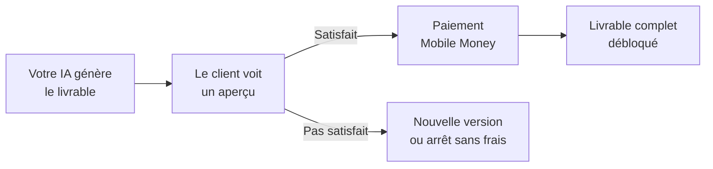

<div align="center">

# PreviewPay

### Vos clients voient le résultat. Ils paient seulement s'ils sont satisfaits.

La brique de paiement **au résultat** pour les produits d'intelligence artificielle :
vous l'intégrez à votre application, vos clients découvrent un aperçu de ce que
votre IA a produit pour eux, puis le débloquent en **Mobile Money**, en quelques
centaines de francs CFA.

**Aperçu gratuit → paiement Mobile Money → livrable débloqué**

[Comment ça marche](#la-solution) ·
[Pour quels produits](#pour-quels-produits) ·
[Intégrer PreviewPay](#intégrer-previewpay) ·
[Démo](#voir-la-démo)

</div>

---

## Le constat

Les outils d'IA se vendent presque tous au même modèle : **un abonnement
mensuel, payé d'avance, en dollars, par carte bancaire.**

Pour une grande partie des utilisateurs, en Afrique de l'Ouest comme ailleurs,
ce modèle bloque l'achat avant même le premier essai :

- **payer avant de savoir** si le résultat sera à la hauteur ;
- **pas de carte internationale**, alors que tout le monde a un compte Mobile Money ;
- **un forfait mensuel** pour un besoin ponctuel : un CV, un logo, une présentation.

Résultat : des visiteurs intéressés qui repartent sans payer, et des produits
d'IA de qualité qui ne trouvent pas leur marché.

## La solution

PreviewPay inverse la logique : **on voit d'abord, on paie le livrable — pas le mois.**

1. **Votre IA produit le livrable.** Il reste sur votre serveur, en entier.
2. **Votre client en découvre un aperçu**, assez pour juger la qualité, pas assez
   pour s'en servir sans payer.
3. **Il valide et paie** en Mobile Money (MTN, Moov), un petit montant fixé par
   vous pour ce livrable précis.
4. **Le livrable complet se débloque** et se télécharge aussitôt.

Pas convaincu par l'aperçu ? Le client peut demander une nouvelle version ou
s'arrêter là, **sans rien payer**.



## Ce que vous y gagnez

**Pour votre produit**

- **Plus de ventes.** La barrière de l'abonnement disparaît : le client paie un
  résultat qu'il a déjà vu.
- **Le moyen de paiement de vos clients.** Mobile Money, en francs CFA, sans carte.
- **Votre travail protégé.** Le livrable complet ne quitte jamais votre serveur
  avant paiement : l'aperçu est fabriqué côté serveur, impossible à contourner
  depuis le navigateur.
- **Moins de litiges.** Le client n'a payé que ce qu'il a validé, et chaque étape
  (aperçu, paiement, déblocage) est enregistrée avec sa preuve.
- **Des chiffres pour piloter.** Taux de validation après aperçu, taux de refus,
  marge par livrable, délai avant paiement, échecs de paiement.

**Pour vos clients**

- Ils jugent sur pièce avant de payer.
- Ils paient un petit montant, une seule fois, avec leur téléphone.
- Ils ne s'engagent sur aucun abonnement.

## Pour quels produits

PreviewPay convient à tout service où **l'IA produit un résultat concret, que
l'on peut montrer en partie avant de le vendre.**

| Type de produit | Ce que le client voit gratuitement | Ce qu'il débloque en payant |
| --- | --- | --- |
| **CV et lettres de motivation** | la mise en page et le début du contenu | le document complet, prêt à envoyer en PDF |
| **Présentations et pitch decks** | les premières diapositives | la présentation entière, modifiable |
| **Logos et identité visuelle** | les propositions en basse résolution, filigranées | les fichiers en haute définition |
| **Visuels et affiches** | le visuel filigrané | le fichier final, prêt à imprimer ou publier |
| **Rédaction et marketing** | l'introduction d'un article, d'une fiche produit, d'un post | le texte complet |
| **Traduction et transcription** | les premiers paragraphes ou minutes | le document ou les sous-titres complets |
| **Business plans et dossiers de financement** | le sommaire et la synthèse | le dossier détaillé avec chiffres |
| **Documents administratifs et modèles** | la structure du courrier ou du contrat type | le document personnalisé complet |
| **Retouche et photos produits** | l'image retouchée en aperçu | l'image en pleine qualité, sans filigrane |
| **Sites et pages web générés** | une capture de la page | le site ou le code source |
| **Éducation et révisions** | une partie des fiches, du plan de cours, des exercices | le support complet |
| **Rapports et analyses de données** | les principaux graphiques | le rapport complet et les données |

Le premier cas d'usage visé : les **plateformes d'agents IA** qui produisent
toutes sortes de livrables à la demande, où chaque résultat devient
directement payable à l'unité.

> Votre produit ne figure pas dans la liste ? S'il fabrique un résultat que
> l'on peut prévisualiser, il est compatible.

## Intégrer PreviewPay

PreviewPay est un **kit de développement (SDK)** que vos développeurs ajoutent à
votre application existante. Il gère pour vous l'aperçu, le paiement Mobile
Money, la vérification du paiement et le téléchargement sécurisé.

**Ce que votre équipe fait :**

1. **Brancher PreviewPay sur votre serveur** (Node.js : NestJS ou Express).
2. **Confier chaque livrable produit par votre IA** à PreviewPay, avec son prix.
3. **Afficher l'écran d'aperçu et de paiement** dans votre interface (composant
   React prêt à l'emploi, ou votre propre design).

```ts
// Votre IA vient de produire un CV : PreviewPay le garde et renvoie l'aperçu.
const livrable = await previewPay.create({ type: "cv", content: cvGenere, ownerId: client.id });
```

```tsx
// Dans votre application : aperçu, prix, paiement Mobile Money, téléchargement.
<PreviewPaywall deliverableId={livrable.id} />
```

Le guide pas à pas pour les développeurs :
**[docs/GETTING-STARTED.md](docs/GETTING-STARTED.md)**.

### Ce qui est déjà pris en charge

- **Paiement Mobile Money** via FedaPay : MTN et Moov au Bénin, Moov au Togo,
  MTN en Côte d'Ivoire.
- **Prix fixé par vous**, par type de livrable, en francs CFA.
- **Paiements confirmés deux fois** : chaque paiement est revérifié auprès de
  l'opérateur avant de débloquer, et un paiement en attente est relancé
  automatiquement si la confirmation de l'opérateur se perd.
- **Nouvelles versions limitées** après un refus, pour maîtriser vos coûts d'IA.
- **Aperçus gratuits plafonnés** par client et par jour, contre les abus.
- **Liens de téléchargement sécurisés**, valables quelques minutes.
- **Open source** (licence MIT) : vous gardez la main sur votre intégration.

## Voir la démo

Le dépôt contient une application complète, **Valora CV**, construite avec
PreviewPay :

1. le client importe son ancien CV en PDF (ses informations sont extraites
   automatiquement) ou remplit un formulaire ;
2. il voit son nouveau CV mis en page, avec les détails masqués ;
3. il paie 200 F CFA en Mobile Money (simulé dans la démo) ;
4. il télécharge son CV complet en PDF.

Lancer la démo : **[docs/DEMO.md](docs/DEMO.md)**.

## Où en est le projet

PreviewPay est en **version bêta (0.1)**.

- ✅ Parcours complet aperçu → paiement → déblocage, testé de bout en bout.
- ✅ Intégration NestJS et Express, composant React, démo Valora CV.
- 🔄 Validation des paiements réels avec FedaPay, en attente du rétablissement
  de leur environnement de test.
- 🔜 Publication des paquets sur npm.

Vous construisez un produit d'IA et souhaitez être parmi les premiers à
l'intégrer ? **Ouvrez une [issue](https://github.com/kennymeadan7-commits/Valora/issues)**
pour en discuter.

---

<sub>Documentation technique : [développer PreviewPay](docs/DEVELOPPEMENT.md) ·
[spécification](<docs/PRD — PreviewPay SDK (aperçu puis paiement au livrable validé).md>) ·
[décisions](docs/DECISIONS.md) · [feuille de route](docs/ROADMAP.md) ·
Licence [MIT](LICENSE).</sub>
